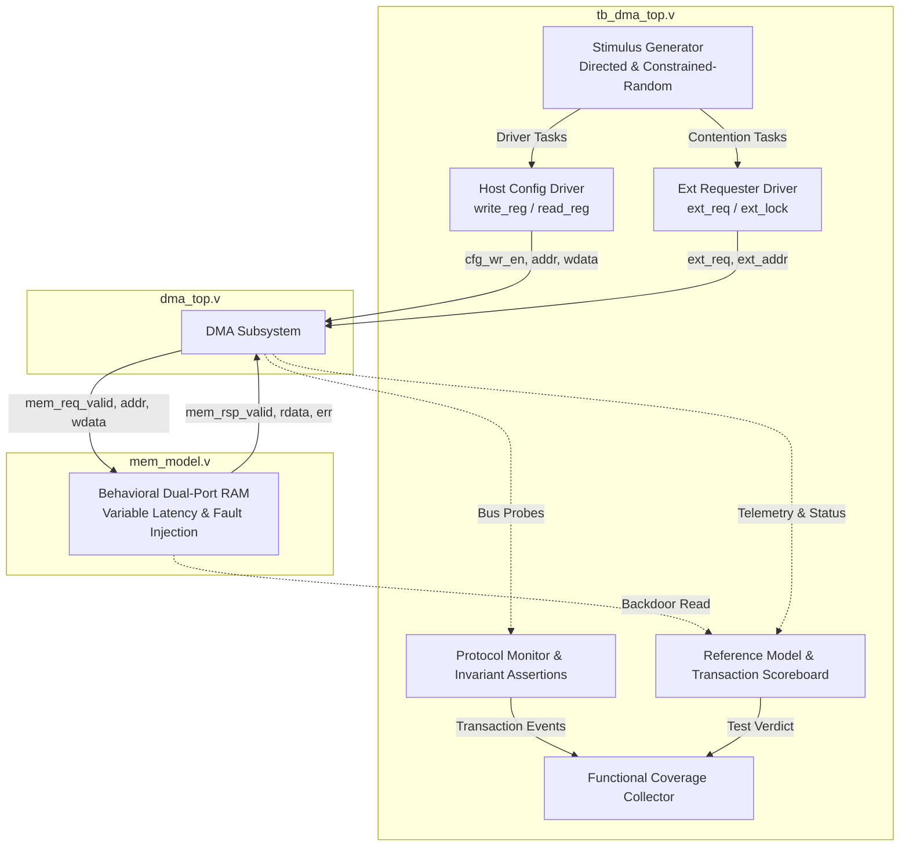

# DMA Subsystem Verification Plan (Phase 3)

**Document Revision**: 2.0  
**Project**: DMA Verification & Performance Analysis Lab  
**Target RTL**: Synthesizable DMA Subsystem (`dma_top`, `dma_controller`, `dma_fifo`, `dma_arbiter`, `dma_reg_file`)  
**Standard**: IEEE 1364-2001 Verilog  
**Lead Verification Engineer**: Senior Hardware Verification Lead  

---

## 1. Overview & Verification Objectives

The primary objective of Phase 3 is to establish a rigorous, self-checking, modular verification infrastructure capable of detecting subtle microarchitectural bugs, edge cases, protocol violations, and data corruptions across all operational modes of the DMA Subsystem.

The verification environment must:
1. Validate end-to-end data integrity with a bit-accurate transaction scoreboard across variable burst lengths and transfer sizes.
2. Verify hardware resilience under negative scenarios: unaligned addresses, zero/fractional transfer lengths, slave bus errors, watchdog timeouts, and backpressure stalls.
3. Verify reliability mechanisms: mid-burst software abort (`CTRL[1]`) and soft reset recovery (`CTRL[3]`) without dangling transactions or locked buses.
4. Stress-test multi-master arbitration under concurrent contention with variable memory response latencies (0 to 4 cycles).
5. Implement protocol assertions enforcing word alignment, FIFO boundary invariants, mutual exclusion, and burst lock non-preemption.
6. Provide a quantifiable functional coverage model and deterministic pseudorandom stimulus generation with recorded seeds.

---

## 2. Verification Architecture

### 2.1 Key Testbench Components
- **Stimulus Generator**: Supports both deterministic directed testcases and parameterized constrained-random generation with recorded random seeds.
- **Reference Memory Model (`mem_model.v`)**:
  - Parameterized access latency (0-cycle zero-wait-state up to N-cycle pipelined delays).
  - Programmable slave stall injection to emulate severe memory backpressure.
  - Programmable bus error injection (`mem_rsp_err`) to validate fault handling.
  - Backdoor initialization and verification tasks (`backdoor_init_pattern`, `backdoor_read_word`).
- **Transaction Scoreboard**:
  - Compares source memory against destination memory word-by-word.
  - Computes transfer latency, effective bandwidth (Bytes/cycle), and flags the exact word offset, address, expected word, actual word, and bitwise difference upon mismatch.
- **Protocol Monitor & Invariant Assertions**:
  - Real-time protocol checks continuously inspecting interface pins and internal probes.
- **Functional Coverage Collector**:
  - Bins coverage across burst lengths, transfer sizes, error types, latencies, and arbitration modes.

---

## 3. Protocol Invariants & Assertion Plan

The testbench continuously evaluates the following protocol invariants during simulation:

| Assertion ID | Monitored Invariant | Failure Condition | Diagnostic Action |
| :--- | :--- | :--- | :--- |
| **ASSERT_ALIGN** | Word Address Alignment | `mem_req_valid && mem_req_ready && (mem_req_addr[1:0] != 2'b00)` | Immediate error banner; simulation abort |
| **ASSERT_MUTEX** | FSM State Mutual Exclusivity | `engine_busy && engine_done` | Immediate error banner; fatal flag |
| **ASSERT_FIFO_OVF** | FIFO Overflow Invariant | `fifo_wr_en && fifo_full && !fifo_rd_en` | Error logged; flags illegal push at capacity |
| **ASSERT_FIFO_UDF** | FIFO Underflow Invariant | `fifo_rd_en && fifo_empty` | Error logged; flags illegal pop on empty |
| **ASSERT_BURST_LOCK** | Non-Preemption During Lock | `arb_burst_lock[0] && arb_req[0] && !arb_grant[0]` | Error logged; flags illegal arbiter preemption |
| **ASSERT_LEN_BOUND** | Transferred Bytes Upper Bound | `bytes_done > reg_xfer_len` | Immediate error banner; flags counter overflow |

---

## 4. Test Matrix

### 4.1 Directed Positive Functional Tests
- **TC01**: Power-On Reset & Default CSR Verification
- **TC02**: Single-Word Transfer (Burst = 1 beat, 4 bytes)
- **TC03**: 2-Beat Burst Transfer (16 bytes = 4 words)
- **TC04**: 4-Beat Burst Transfer (64 bytes = 16 words)
- **TC05**: 8-Beat Burst Transfer (128 bytes = 32 words)
- **TC06**: Incomplete Remainder Burst (4-beat bursts with 1-word remainder, 20 bytes)
- **TC07**: FIFO Backpressure Flow Control with intermittent slave memory stalls
- **TC08**: Multi-Master Fixed-Priority Arbitration Contention
- **TC09**: Multi-Master Round-Robin Arbitration Contention (50/50 fair sharing)

### 4.2 Directed Corner-Case & Negative Tests
- **TC10**: Zero Transfer Length (`XFER_LEN = 0`) -> Verify rejection (`ERR_INVALID_CFG`, STATUS[2])
- **TC11**: Fractional / Non-Word Transfer Length (`XFER_LEN = 14`) -> Verify rejection (`ERR_INVALID_CFG`)
- **TC12**: Unaligned Source Address (`SRC_ADDR = 0x1002`) -> Verify rejection (`ERR_ALIGN`, STATUS[4])
- **TC13**: Unaligned Destination Address (`DST_ADDR = 0x2001`) -> Verify rejection (`ERR_ALIGN`, STATUS[4])
- **TC14**: Bus Error Injection during Read (`mem_rsp_err == 1`) -> Verify engine halts gracefully, clears busy, asserts `ERR_BUS` (STATUS[5]), and fires IRQ.
- **TC15**: Bus Error Injection during Write (`mem_rsp_err == 1`) -> Verify engine halts gracefully, asserts `ERR_BUS` (STATUS[5]), and fires IRQ.
- **TC16**: Watchdog Timeout Detection -> Force memory stall beyond `TIMEOUT_CYCLES` -> Verify engine halts, asserts `ERR_TIMEOUT` (STATUS[3]), and releases arbiter lock.
- **TC17**: Mid-Burst Software Abort -> Write `CTRL[1] = 1` during multi-beat burst -> Verify FSM returns to `IDLE`, clears busy, releases arbiter lock, and records partially transferred `BYTES_DONE`.
- **TC18**: Mid-Burst Soft Reset Recovery -> Write `CTRL[3] = 1` during active transfer -> Verify full reset of FSM, FIFO, and registers to default state; verify subsequent transfer executes cleanly.
- **TC19**: Zero-Wait-State Memory Access -> Configure memory latency = 0 cycles -> Verify high-throughput back-to-back burst transfer without pipeline bubble stalls.
- **TC20**: High-Latency Memory Access -> Configure memory latency = 4 cycles -> Verify transfer completes successfully with correct FIFO lookahead and handshaking.
- **TC21**: FIFO Boundary Saturation -> 64-word transfer exceeding FIFO depth with throttled reads -> Verify no overflow or underflow flags assert.

### 4.3 Randomized Testing Suite
- **TC22**: Constrained-Random Iteration Suite (25 randomized transfers):
  - Random seed recorded in simulator log and JSON summary.
  - Random transfer length: 4 to 256 bytes (word-aligned).
  - Random burst configuration: 1, 2, 4, 8 beats.
  - Random memory latency: 0, 1, 2, 3 cycles.
  - Random memory base addresses within valid 64 KB space.
  - Full scoreboard verification on all 25 transfers.

---

## 5. Functional Coverage Model

Functional coverage is partitioned into 6 distinct feature categories:

1. **Burst Size Bins (4 bins)**:
   - `BURST_1_BEAT`, `BURST_2_BEAT`, `BURST_4_BEAT`, `BURST_8_BEAT`
2. **Transfer Length Bins (5 bins)**:
   - `LEN_SINGLE_WORD` (4B)
   - `LEN_SHORT` (8B - 16B)
   - `LEN_MEDIUM` (20B - 64B)
   - `LEN_LONG` (68B - 256B)
   - `LEN_REMAINDER` (non-power-of-two burst remainder)
3. **Fault & Error Handling Bins (7 bins)**:
   - `ERR_ZERO_LEN`, `ERR_UNALIGNED_LEN`, `ERR_UNALIGNED_SRC`, `ERR_UNALIGNED_DST`
   - `ERR_BUS_READ`, `ERR_BUS_WRITE`, `ERR_TIMEOUT`
4. **Reliability & Control Bins (2 bins)**:
   - `CTRL_SW_ABORT`, `CTRL_SOFT_RESET`
5. **Memory Latency Bins (3 bins)**:
   - `LATENCY_0_CYCLES`, `LATENCY_1_CYCLE`, `LATENCY_MULTI_CYCLE`
6. **Arbitration & Contention Bins (3 bins)**:
   - `ARB_FIXED_PRIORITY`, `ARB_ROUND_ROBIN`, `ARB_BURST_LOCKED`

**Target**: 100% bin coverage across all 24 coverage bins.

---

## 6. Pass / Fail Acceptance Criteria

A test run is considered **PASSED** if and only if:
1. All directed tests (TC01 - TC21) and all randomized iterations (TC22) pass without scoreboard mismatches.
2. Zero protocol assertion violations occur throughout the simulation.
3. Every error condition results in the correct status bit latch and graceful FSM halt (never hanging in an infinite loop).
4. Functional coverage achieves 100% across all 24 coverage bins.
5. All simulation logs and structured JSON metrics are generated deterministically.
